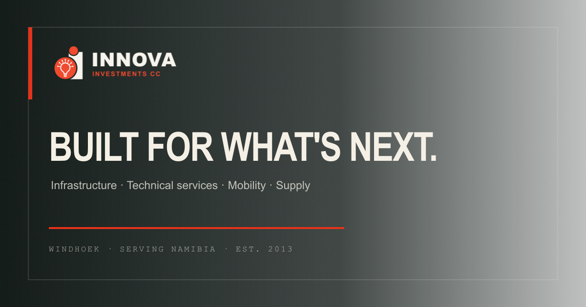
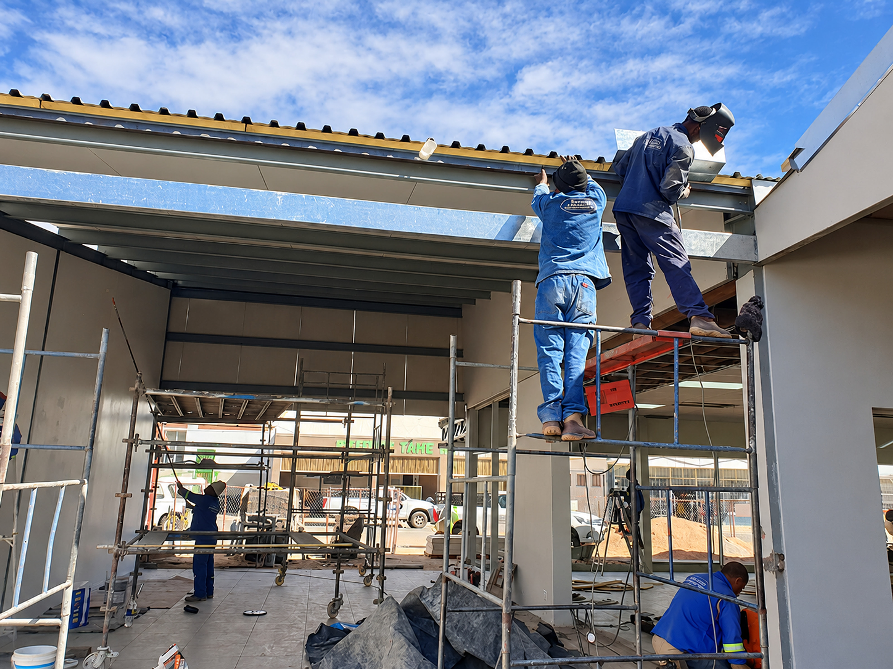
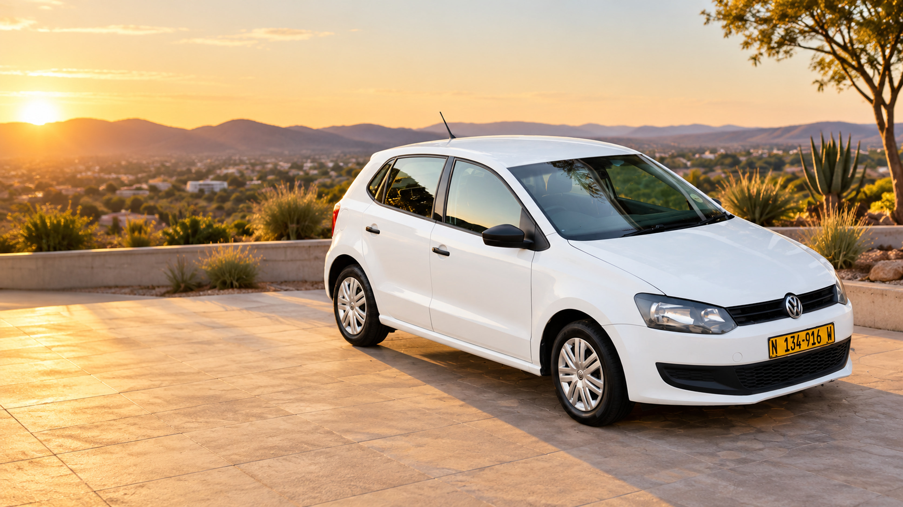
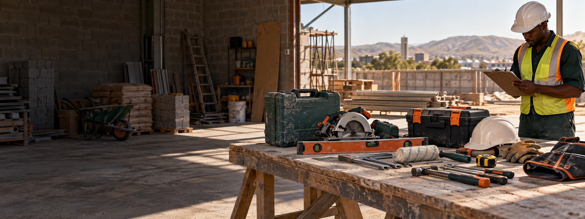

<h1 align="center">Innova — The work. Properly handled.</h1>

  <strong>A clearer public presence and a more accountable way to handle work for a Namibian business with a wide practical reach.</strong> 
  Identity refinement, experience design and development by SolarSpin Technologies.

  <a href="https://innova-namibia-operations.freeman-ipumbu634390.chatgpt.site/"><strong>Explore the current build ↗</strong></a>
  &nbsp;·&nbsp;
  <a href="https://innovaptyltd.com/">Innova's original website</a>
  &nbsp;·&nbsp;
  <a href="https://solarspin-namibia.xyz/">SolarSpin Technologies</a>

<strong>Innova Investments CC · Windhoek, Namibia · Established 2013</strong>

## The brief

Innova's work crosses civil construction, property trades, site services, printing, procurement, transport, car rental and private tours. Its [original site](https://innovaptyltd.com/services/) documented that range, but a visitor needed a clearer route from a specific need to the right conversation. The project brief was also operational: put new requests, bookings and follow-up into a system where they can be found and owned.

The resulting experience gives the public site and the business desk a shared structure. Visitors can find a capability, describe the real requirement and submit a request with context. The team can then qualify, assign and follow it through.

## Keep the breadth. Give it order.

The original offering was retained and organized into **36 named capabilities across four groups**:

| Capability group | Examples in the public service index |
| --- | --- |
| **Build & civil** | Construction and renovations, road work, paving, land servicing, concrete, water and drainage |
| **Technical services** | HVAC, electrical, plumbing, painting, tiling, carpentry and property maintenance |
| **Environmental & site** | Debushing, clearing, cleaning, refuse removal and security support |
| **Business, mobility & supply** | Transport, car rental, tours, printing, branding, PPE and procurement |

Search and group filters make the service index usable without shrinking the business to a few headline categories. Project and engineering pages ask for site, scope, timing and commercial context. The company-family page preserves the names and supplied identities shown in Innova's original portfolio; it does not imply that each venture has the same current operating status.

*This is Innova source project imagery presented for the website. Representative brief patterns elsewhere in the experience are examples, not a record of completed projects.*

## A serious visual language for a working business

The refreshed identity keeps Innova's recognizable red symbol and name while making the lockup and supporting company marks scalable and consistent. Ink, warm paper, sand and a direct red accent carry the interface. Large editorial type, close-up field imagery, survey lines and numbered operating steps give the pages a practical Namibian character.

The visual system uses real supplied fleet and project material where available. The supply catalogue uses clearly identified representative product imagery; an image does not promise a specific brand, model or live stock position. The same distinction applies to tours and illustrative project briefs.

## From enquiry to accountable work

The public journeys are deliberately specific:

| Journey | What the visitor can do |
| --- | --- |
| **Services** | Find a named capability and send a brief against it. |
| **Projects & engineering** | Describe the site, scope, timing and intended outcome before a quotation conversation. |
| **Supply catalogue** | Choose from 20 photographed item classes and request the required specification, quantity and date. |
| **Rentals & tours** | View Innova's four listed Volkswagen Polo vehicles, request dates, or enquire about a private journey. |
| **Contact** | Use a structured request, telephone, email or WhatsApp. |
| **Client portal** | Open a private link issued for a submitted request to view its status and related work. |

The request form creates a reference and records the submission for the operating team. Rental requests are enquiries until the team confirms availability and terms. The public catalogue likewise asks the supply desk to confirm actual stock, price and specification.

*The fleet is shown from Innova's supplied vehicle material, enhanced for presentation. Vehicle availability and rental terms require direct confirmation.*

## The admin corner

Behind the public experience is a working desk for **requests, customers, schedule, jobs, rentals, fleet, quotes and invoices, team tasks, integrations and site settings**. It is designed around the handoff that informal chat threads often obscure: who owns the next action, what has been agreed, and what needs attention now. The customer portal extends that record to clients through private links.

The Google integration area is prepared for Places, Calendar, Drive, Gmail and Analytics where the owner authorizes and configures those services. This case study does not claim that an external account is connected or that automation has produced measured business outcomes.

*Supply imagery is representative concept photography. Final product details are confirmed by Innova against each request.*

## Built for use

The interface includes phone and desktop navigation, readable forms, semantic controls, visible focus states and reduced-motion handling. Public requests and private operations are backed by server-side records. Sensitive business data and the production implementation are outside this repository; [the publication boundary](PUBLICATION_BOUNDARY.md) explains what is shared here.

## Credits

**Client:** Innova Investments CC, Namibia  
**Identity refinement, creative direction, experience design and development:** [SolarSpin Technologies](https://solarspin-namibia.xyz/)  
**Original site and source material:** [Innova Investments CC](https://innovaptyltd.com/); the earlier site credits VR IT Solutions  
**Current build:** [Innova operations website](https://innova-namibia-operations.freeman-ipumbu634390.chatgpt.site/)

© 2026 Innova Investments CC and SolarSpin Technologies. This public case study is a portfolio record. It grants no right to reuse Innova's identity, imagery, writing or experience as a commercial template.
